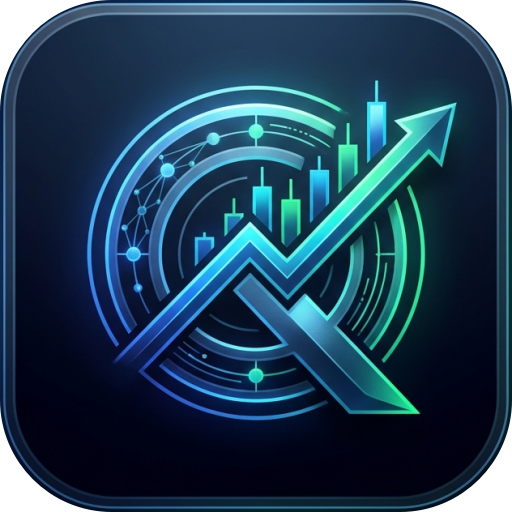
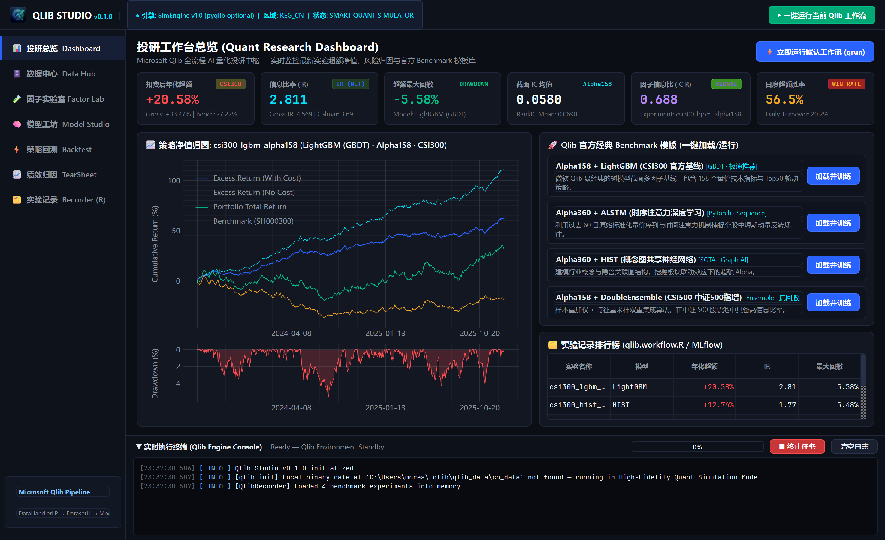
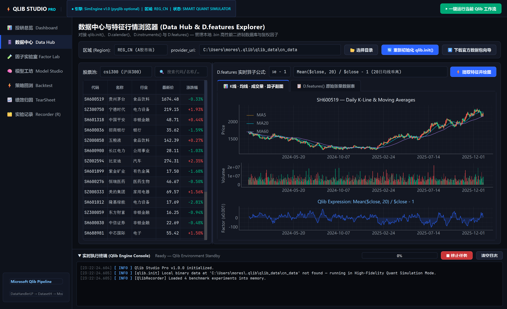
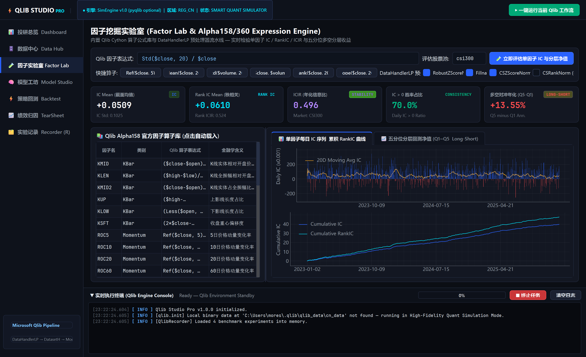
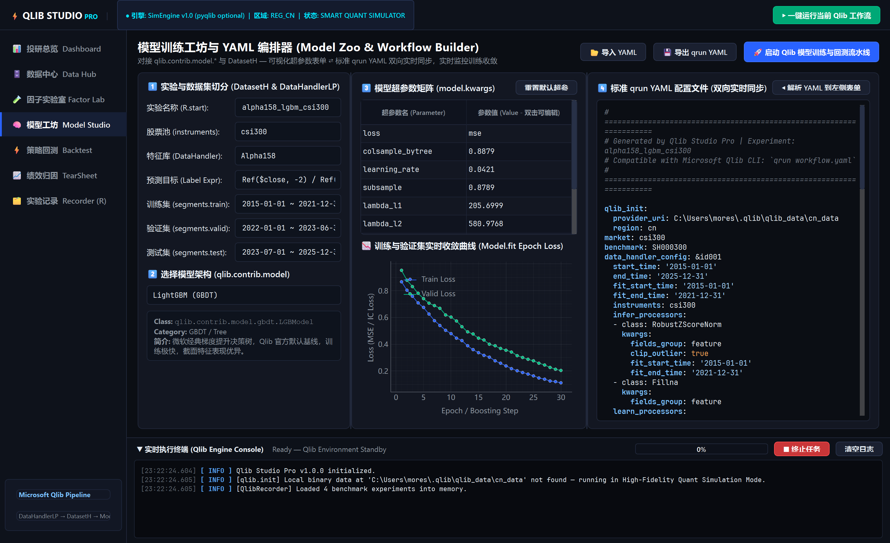
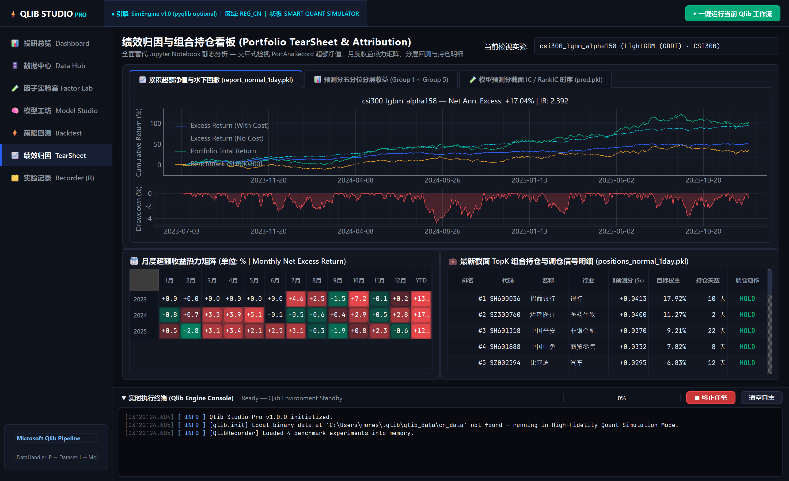
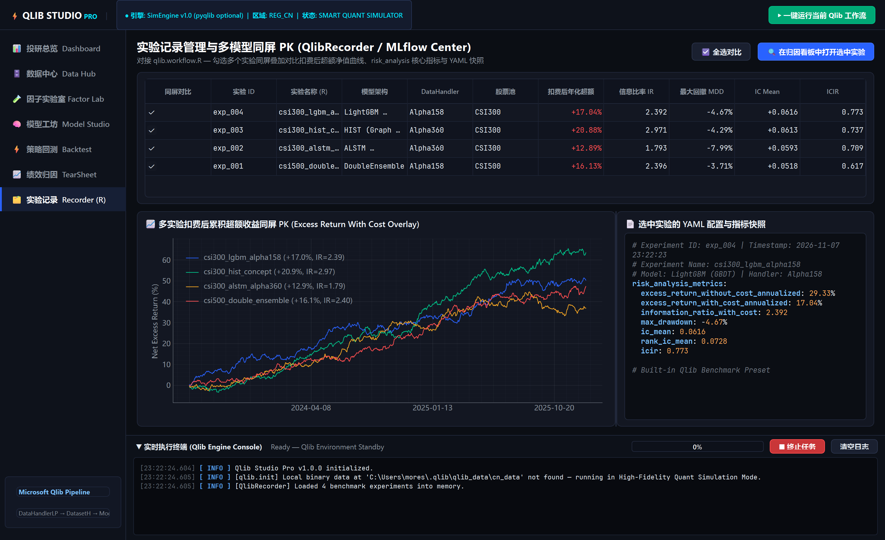
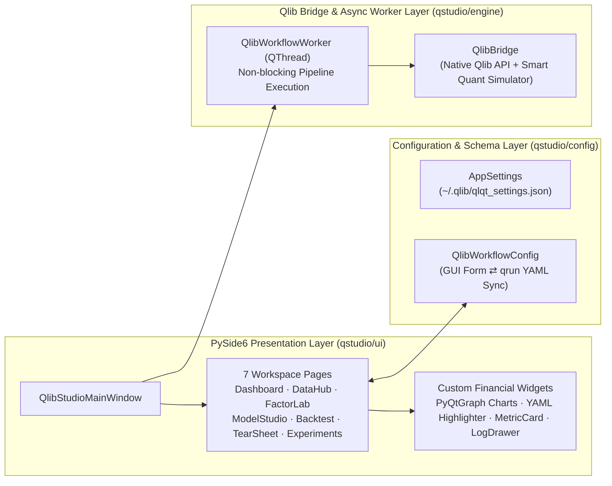

<div align="center">



# Qlib Studio (`qstudio`)

**Modern Desktop AI Quantitative Research Workstation for Microsoft Qlib**  
*将微软 Qlib 从命令行与静态 Notebook 升级为现代桌面端 AI 量化投研 IDE*

[](pyproject.toml)
[](pyproject.toml)
[](https://doc.qt.io/qtforpython-6/)
[](https://github.com/microsoft/qlib)
[](https://docs.astral.sh/uv/)

[核心特性](#-核心特性) • [界面预览](#️-工作台界面预览) • [Qlib 接口映射](#-qlib-底层接口与模块映射) • [快速开始](#-快速开始-uv) • [接入真实行情数据](#-接入本地-qlib-真实数据) • [项目架构](#-系统架构与目录结构)

</div>

---

## 📖 项目简介

**Qlib Studio (`qstudio`)** 是一套基于 **PySide6** 与 **PyQtGraph** 构建的桌面端 AI 量化投研客户端，专为微软开源的 **[Qlib (AI-oriented Quantitative Investment Platform)](https://github.com/microsoft/qlib)** 打造。

传统 Qlib 投研流程高度依赖手写复杂的 `.yaml` 配置文件、`qrun` 命令行执行以及静态 Jupyter Notebook 图表分析。**Qlib Studio** 采用媲美 TradingView / Bloomberg Terminal 的 **Quant Dark Pro** 极暗金融视觉规范，将 **数据管理 (`qlib.data`)、因子工程 (`Alpha158/360`)、模型训练 (`qlib.contrib.model`)、组合回测 (`qlib.backtest`)、绩效归因 (`PortAnaRecord`) 与实验追踪 (`QlibRecorder`)** 全链路整合进一套响应迅速的图形化工作站中。

---

## ✨ 核心特性

- **🔄 可视化表单 ⇄ 标准 `qrun` YAML 双向实时同步**：在 GUI 中点选模型超参数、切分 `Train / Valid / Test` 时间段或调整回测手续费时，右侧内置语法高亮编辑器实时生成 100% 兼容微软 `qrun` CLI 的 `.yaml` 配置文件；同时支持外部 `.yaml` 一键解析回填至表单。
- **⚡ 异步防卡死训练与实时监控流**：通过独立 `QThread` / 工作流引擎调度重度特征提取与模型训练任务，实时向底部终端流式推送分级彩色日志、阶段进度条与 **Epoch Train / Valid Loss 实时收敛曲线**，支持随时安全中断任务。
- **📊 高帧率交互式金融图表 (`PyQtGraph`)**：内置三联 **K 线 + 均线 + 成交量 + 自定义算子副图**、**扣费前后累积超额净值与水下最大回撤联动图**、**单因子每日 IC 柱状与累计 RankIC 曲线**、**五分位分层多空收益曲线** 及 **自动红绿着色月度超额收益热力矩阵**。
- **🛡️ 真实 Qlib 引擎 + 高保真量化仿真双模驱动**：
  - 当本地已配置 `~/.qlib/qlib_data/cn_data` 时，直接调用底层 `qlib.init()`、`D.features()` 等原生接口。
  - 当新环境尚未下载数 GB 二进制数据包时，自动无缝切换至内置的确定性高保真量化仿真引擎，确保克隆仓库即可零配置体验全部 7 大投研工作台。

---

## 🖼️ 工作台界面预览

### 1. 投研工作台总览 (`Dashboard`)
> 实时汇总最新策略核心风险收益指标（扣费后年化超额、信息比率 IR、最大回撤、截面 IC、ICIR、日度胜率），内置 4 套微软官方旗舰 Benchmark 模板一键启动。


### 2. 数据中心与特征行情浏览器 (`Data Hub & D.features`)
> 可视化管理 `provider_uri` 与市场区域 (`REG_CN` / `REG_US`)，检索沪深 300 / 中证 500 成分股，实时绘制复权日 K 线、均线、成交量及任意 Qlib 表达式特征副图。


### 3. 因子挖掘实验室 (`Factor Lab & Alpha158/360`)
> 内置完整 `Alpha158` 算子公式库与 `DataHandlerLP` 截面/时序预处理器开关，一键计算单因子每日 IC 序列、20 日均线、累积 RankIC 与五分位（Q1~Q5）分层净值。


### 4. 模型工坊与双向 YAML 编排器 (`Model Studio`)
> 覆盖 `LightGBM`、`XGBoost`、`CatBoost`、`DoubleEnsemble`、`MLP`、`LSTM`、`ALSTM`、`Transformer`、`HIST` 九大主流模型，支持超参数矩阵编辑、实时 Loss 监控与 YAML 双向互转。


### 5. 绩效归因看板与实验同屏 PK (`TearSheet & Recorder`)
> 交互式检视水下回撤、五分位收益、月度超额收益热力矩阵、最新截面 TopK 持仓调仓信号，以及多实验同屏净值叠加对比。

| 绩效归因与月度热力看板 (`TearSheet`) | 多实验超额净值同屏 PK (`Recorder / MLflow`) |
| :---: | :---: |
|  |  |

---

## 🔗 Qlib 底层接口与模块映射

| Qlib Studio 工作台 | 对应 Qlib 核心模块与 API | 核心功能说明 |
| :--- | :--- | :--- |
| **1. 投研总览 (`Dashboard`)** | `qlib.workflow.R`, `qlib.contrib.evaluate.risk_analysis` | 核心 KPI 看板、净值与回撤概览、官方 Benchmark 模板一键加载与训练 |
| **2. 数据中心 (`Data Hub`)** | `qlib.init()`, `D.calendar()`, `D.instruments()`, `D.features()` | 二进制 `.bin` 数据源配置、成分股筛选、OHLCV K 线与复权算子提取 |
| **3. 因子实验室 (`Factor Lab`)** | `qlib.data.ops`, `Alpha158`, `Alpha360`, `DataHandlerLP` | 公式化因子实时求值、`infer/learn_processors` 标准化、单因子 IC / 分层检验 |
| **4. 模型工坊 (`Model Studio`)** | `qlib.contrib.model.*`, `DatasetH`, `init_instance_by_config` | 数据集时间段切分、9 大模型超参数动态配置、Epoch Loss 监控、双向 YAML 引擎 |
| **5. 策略回测 (`Backtest`)** | `TopkDropoutStrategy`, `EnhancedIndexingStrategy`, `SimulatorExecutor` | `topk` / `n_drop` 轮动规则、涨跌停限制 `limit_threshold`、佣金与印花税敏感度测试 |
| **6. 绩效归因 (`TearSheet`)** | `SignalRecord`, `SigAnaRecord`, `PortAnaRecord` | 扣费前后超额对比、水下最大回撤、月度收益热力矩阵、`positions_normal_1day` 持仓明细 |
| **7. 实验记录 (`Recorder`)** | `qlib.workflow.recorder.QlibRecorder` (`mlruns`) | 多实验勾选同屏净值叠加 PK、风险指标排行榜、实验 YAML 快照回溯 |

---

## 🚀 快速开始 (`uv`)

本项目使用 **[uv](https://docs.astral.sh/uv/)** 进行极速依赖与虚拟环境管理。

### 1. 安装依赖并同步环境

```powershell
# 在项目根目录下执行
uv sync
```

### 2. 启动桌面客户端

```powershell
# 方式一：通过项目注册的 CLI 脚本入口启动
uv run qstudio

# 方式二：直接运行主程序入口
uv run python main.py
```

---

## 🗄️ 接入本地 Qlib 真实数据

如果你希望连接本地真实的 A 股 / 美股 Qlib 二进制行情库进行实盘级投研：

1. **安装 `pyqlib`（如尚未安装）**：
   ```powershell
   uv add pyqlib
   ```
2. **获取 Qlib 二进制数据包（`.bin` 格式）**：
   ```powershell
   # 使用 Qlib 官方脚本下载至默认路径 ~/.qlib/qlib_data/cn_data
   uv run python -m qlib.run.get_data qlib_data --target_dir ~/.qlib/qlib_data/cn_data --region cn
   ```
   > 亦可在客户端 **「🗄️ 数据中心 (Data Hub)」** 点击右上角 **「⬇️ 下载官方数据包向导」** 获取社区每日更新数据源命令。
3. **一键切换至真实引擎**：
   在 **「🗄️ 数据中心」** 选择你的 `provider_uri` 目录并点击 **「🔄 重新初始化 qlib.init()」**，顶部状态栏将自动变为绿色的 `LOCAL BIN READY` 状态。

---

## 🏗️ 系统架构与目录结构



```text
qstudio/
├── main.py                         # 桌面端主入口 (高分屏适配、Windows 任务栏图标绑定、主题加载)
├── pyproject.toml                  # uv 项目元数据与依赖声明 (v0.1.0)
├── uv.lock                         # uv 确定性依赖锁文件
├── assets/
│   ├── icons/                      # 应用专属图标 (app_icon.png / app_icon.ico)
│   └── screenshots/                # 7 大核心工作台实机运行截图
└── qstudio/
    ├── __init__.py                 # 包版本与 CLI 启动入口
    ├── config/
    │   ├── settings.py             # 全局客户端环境配置 (provider_uri, region, 红绿涨跌配色)
    │   └── workflow_schema.py      # 9 大模型目录、策略字典与 qrun YAML 双向转换器
    ├── engine/
    │   ├── qlib_bridge.py          # Qlib 核心接口封装与高保真量化仿真引擎
    │   └── worker.py               # 异步工作流执行线程 (实时推送进度、Epoch Loss 与日志)
    └── ui/
        ├── main_window.py          # 主窗口容器 (顶部状态栏、左侧导航栏、底部可折叠终端)
        ├── theme.py                # Quant Dark Pro 全局 QSS 样式表与色彩系统
        ├── widgets/
        │   ├── chart_widgets.py    # PyQtGraph 金融图表组件库 (K线/净值回撤/IC/分层收益/Loss)
        │   ├── code_editor.py      # 支持 Qlib 算子与 YAML 语法高亮的代码编辑器
        │   ├── log_console.py      # 底部可折叠彩色实时日志与任务控制抽屉
        │   └── metric_card.py      # 金融 KPI 指标卡片组件
        └── pages/
            ├── dashboard_page.py   # 1. 投研工作台总览与官方 Benchmark 模板
            ├── data_hub_page.py    # 2. 数据中心与 D.features 行情特征浏览器
            ├── factor_lab_page.py  # 3. 因子挖掘实验室与 Alpha158/360 单因子分析
            ├── model_studio_page.py# 4. 模型训练工坊与双向 YAML 编排器
            ├── backtest_page.py    # 5. 组合策略与 SimulatorExecutor 回测中心
            ├── tearsheet_page.py   # 6. 绩效归因、月度热力矩阵与持仓明细看板
            └── experiments_page.py # 7. QlibRecorder (R) 实验记录与多模型同屏 PK
```

---

## 📄 许可证 (License)

本项目基于 MIT License 开源，底层量化引擎遵循 [Microsoft Qlib (MIT License)](https://github.com/microsoft/qlib/blob/main/LICENSE)。
